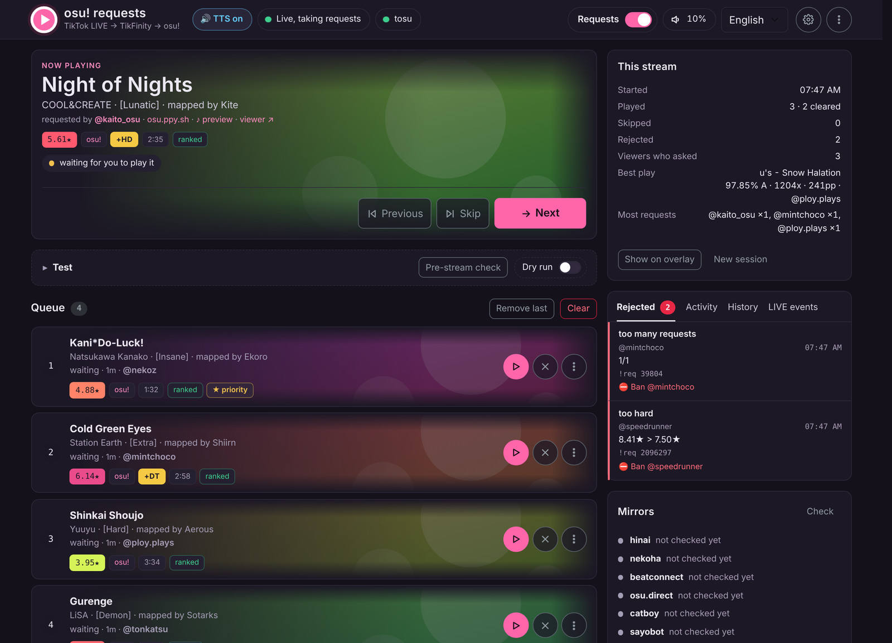
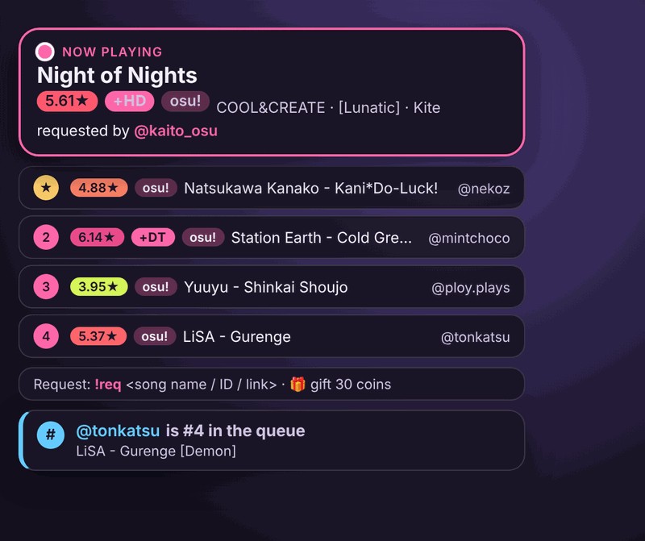
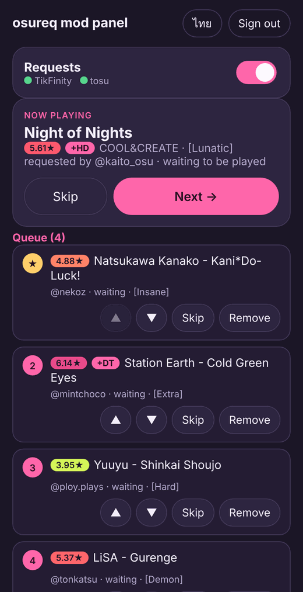

# osureq: osu! song requests from TikTok LIVE chat

**English** · [Thai](docs/README.th.md)

A Windows helper for osu! streamers that lets TikTok LIVE viewers request maps in chat with `!req <ID or link>`.
osureq checks the rules, downloads the map, verifies the file and opens the maps in osu! one at a time. It comes with a
dashboard for managing the queue (English/Thai) and an overlay for OBS. Everything lives in a single `osureq.exe`, with no installer.

[](https://github.com/Lacrymiraosu/tiktoklivereqsong/actions/workflows/build.yml)

## Overview

**Dashboard**: the map being played, the queue with one-click controls, rejected requests, history and a summary of the stream.



| OBS overlay | Mod panel on a phone |
|---|---|
|  |  |
| What viewers see on stream: now playing, the next requests, how to request, and answers to `!pos`, `!np` and rejected requests. | Mods run the queue from a phone on the same Wi-Fi, with a PIN. |

<sub>Screenshots use example data.</sub>

## Features

* Takes requests from TikTok chat through TikFinity, or **straight from TikTok** without any other program (see [Chat without TikFinity](#chat-without-tikfinity)), as IDs, any common osu! link or a **song name** (`!req freedom dive`), optionally **with mods** (`!req 2096297 HDHR`)
* **Several maps in one message** when you allow it (`!req 2096297 1859353 HDHR`, up to 5; see [Several maps in one message](#several-maps-in-one-message))
* Rules: star range (per mode if you like), length, mode, ranked status, requests per viewer, cooldown, duplicates, bans, followers only
* Downloads from mirrors (hinai → Nekoha → beatconnect → osu.direct → catboy.best → Sayobot → the official site; a mirror that fails hands over to the next) and checks the MD5 against the current version on osu!
* Opens the map in osu! (stable and lazer) when you press **Next**, or automatically once the previous song has ended (seen through tosu)
* All four modes: osu!, taiko, catch and mania (converts use osu!'s star rating for that mode)
* The overlay tells viewers whether a request was added or why it was rejected, and shows now playing, the upcoming queue and play results
* Viewer commands (`!pos` queue position, `!np` now playing, `!voteskip`) answered on the overlay, with viewers' TikTok pictures
* Mod commands (`!skip`, `!remove`, `!reqon`, `!reqoff`), queue priority for gifts, gift-only requests, one-click bans, audio previews
* Test panel: simulated chat and gifts, a dry run that never touches the game, and a **pre-stream check** of the whole chain
* Session summary (maps played, best play, top requesters) on the dashboard and, on request, the overlay
* Fair queue (viewers take turns), requests that close by themselves at a queue size or a time, bans for a whole song or artist (`artist="a_hisa"`)
* **▶ view map** on queue, now-playing and history cards: [KIKI Beatmap Viewer](https://api.kiki-bm.app/)'s player opens under the card with the requested mods (osu!standard maps; see [Watching a map](#watching-a-map))
* How many people are watching (👁 1,234) next to the connection status, in the dashboard and on the mod panel
* Optional mod panel: run the queue from a phone on the same Wi-Fi, protected by a PIN
* Streaming from **two PCs**: OBS on the other PC loads the overlay with a secret link ([Two PCs: overlay on the OBS PC](#two-pcs-overlay-on-the-obs-pc))
* Optional chat TTS that reads chat aloud but never the commands (`!req …`), links or emoji, instead of TikFinity's TTS, and spoken announcements ("test1 requested …", "… is too hard, 7.25 stars") from lines you write ([recommended](#text-to-speech-use-osureqs-own-tts))
* A support file (log, raw events, settings) to send after a stream with a problem
* Switches between stable and lazer to match tosu, and updates itself: a new osureq is downloaded from the GitHub releases, checked and installed the next time you start it
* Close tosu, TikFinity or everything from the dashboard

## Requirements

* Windows 10/11, 64-bit
* osu! **stable** or **lazer**
* [**TikFinity Desktop**](https://tikfinity.zerody.one/), connected to the TikTok account and running while you are live (osureq reads chat through it),
  **or** nothing at all with **TikTok direct** (Settings → Connection, see [Chat without TikFinity](#chat-without-tikfinity))
* [**tosu**](https://github.com/tosuapp/tosu/releases/latest), running while you are live (tells when a song has ended and records results)
* OBS or TikTok LIVE Studio, for the overlay
* A recent browser for the dashboard: Chrome or Edge 130, Firefox 132 or Safari 18, or newer

## Getting started

1. Download `osureq-<version>-windows-x64.zip` from [Releases](https://github.com/Lacrymiraosu/tiktoklivereqsong/releases/latest)
   and unzip it into a folder of its own, e.g. `C:\osureq\` (it creates `config.json`, `queue.json`, `osureq.log` and a `cache\` folder next to itself).
2. Start TikFinity, tosu and osu!.
3. Double-click `osureq.exe`. A CMD window shows the log (closing it stops osureq) and the dashboard opens at <http://127.0.0.1:21280/>.
4. In **Settings → osu!**, choose stable or lazer. Set the rules you want (stars, length, modes, bans …) with the **Map rules** button above the queue.
5. For the overlay, add a **Browser Source** in OBS with `http://127.0.0.1:21280/overlay` (transparent background).

Use the **Test** panel on the dashboard to try the whole chain before you go live.

### Chat without TikFinity

In **Settings → Connection → Chat comes from**, pick **TikTok direct** and type your TikTok @name. osureq then reads the LIVE
itself: chat, gifts and viewer roles, with nothing else to install or keep open. When you are not live it checks every 30 seconds
and connects as soon as the LIVE starts. The status pill at the top of the dashboard then also shows how many people are watching
(👁 1,234), and so does the mod panel. With TikFinity the number appears only when TikFinity passes it on.

TikTok only lets a connection in when its address is signed. [Euler Stream](https://www.eulerstream.com) signs it (the sign
server TikTok-Live-Connector uses). Only connecting counts, chat does not: without an API key that is 30 connections an hour and
100 a day, plenty for one stream. A free key from eulerstream.com allows more; put it in **Euler Stream API key**. It stays on
your PC and is hidden in the support file. TikFinity stays available with the same switch.

### Text to speech: use osureq's own TTS

We recommend osureq's TTS over TikFinity's, because **osureq can say what was requested**. TikFinity only sees the chat
text, so it reads `!req 129891 HDHR` out as a string of numbers and letters. osureq knows the map behind the request and says its name:

> “test1 requested FREEDOM DiVE by xi, mapped by Nakagawa-Kanon, FOUR DIMENSIONS HDHR”

* It announces what happens to requests: added, rejected with the reason (“FREEDOM DiVE is too hard, 7.25 stars”), the next
  map, `!np`, play results and gifts. Every line can be changed in **Settings → TTS**, with `{title}`, `{artist}`, `{mapper}`,
  `{diff}`, `{mods}`, `{stars}` and more.
* It reads the rest of the chat but never commands (`!req …`), links or emoji.
* It can read only subscribers (ใจส้ม), followers, gifters or mods.

To use it, turn on **Read chat aloud** and **Announce requests** in **Settings → TTS**, and if TikFinity is running, **turn its TTS off** so chat
is not read twice. TTS starts when the dashboard opens (if the browser asks for a click first, click anywhere on the page) and
OBS records it as desktop audio. Windows has no Thai voice, so **Who speaks: auto** uses Google's voice for Thai, which sends the
text being read to Google.

### What viewers type

```
!req 2096297                                      ← difficulty ID (tried as a set ID if no such difficulty exists)
!req https://osu.ppy.sh/beatmapsets/962870#mania/2096297
!req https://osu.ppy.sh/beatmapsets/962870        ← whole set: the hardest difficulty that passes the rules
!req freedom dive                                 ← song name: the most played title match that passes the rules
!req 2096297 HDHR                                 ← with mods (a song name takes them as +HDHR at the end)
!remove                                           ← removes your own latest request
!pos                                              ← where are my requests in the queue
!np                                               ← what osu! is playing (from tosu) and who asked for it
```

With vote skip turned on (Settings → Command), viewers can type `!voteskip`. Mods can also use `!skip` (skip the song being played), `!remove @user` and `!reqon` / `!reqoff` (open/close requests).
Every command name can be changed in the settings.

### Several maps in one message

A message asks for one map by default. Raise **Settings → Command → Maps per message** (1 to 5) and a viewer can request
several at once, with mods written after the map they belong to:

```
!req 2096297 1859353 HDHR 1521430                 ← three requests; HDHR goes with 1859353
```

* It only counts when every word after the command is a map ID, an osu! link or mods. A song name, or an ID followed by chat
  (`!req 2096297 please`), works as before.
* Every map goes through all the rules on its own and counts toward the viewer's requests per person. The same map twice counts
  once, and a wrong mod (`+HDXX`) rejects only that map.
* The cooldown is checked once per message. When the problem is the viewer (cooldown, request limit, full queue, requests closed,
  ban, followers only, no gift), the rest of the message is dropped with one pop-up. Maps over the limit are ignored, and a pop-up says so.
* With gift-only requests each map costs one request.
* The overlay shows every map; TTS says each outcome once and at most two lines per message.
* In the **Test** panel, type IDs or links (each may be followed by mods, e.g. `2096297 HDHR`) and the command is added for you.

### Watching a map

The **▶ view map** button on queue, now-playing and history cards opens a map player under the card, with the map, its hitsounds and
the mods that were requested. One player is open at a time, and starting it pauses the ♪ preview (and the other way round).

* The player is [KIKI Beatmap Viewer](https://api.kiki-bm.app/) (player.kiki-bm.app): free, no key. It runs in your browser, osureq loads
  no script from KIKI: it shows their page in a frame and sends it messages.
* osu!standard only. Taiko, catch, mania and converts have no ▶, and neither have history entries saved before osureq recorded the mode.
* When osureq has already downloaded and checked the map, the player gets that file. Otherwise it loads the map from the community
  mirrors by itself. If loading fails, press ▶ in the player again; osureq then lets it use the mirrors.
* The player's own ⓘ credits stay visible, as KIKI asks (its default skin and hitsounds are by ppy, CC BY-NC 4.0).
* Turn it off in **Settings → osu! → KIKI map viewer** (one switch for the dashboard, one for the mod panel). The mod panel has the same ▶,
  always from the mirrors. The "viewer ↗" link to a beatmap viewer is still there: by default KIKI Beatmap Viewer's site (kiki-bm.app),
  or your own in **Settings → osu! → Beatmap viewer URL**.

### Two PCs: overlay on the OBS PC

OBS on another PC cannot open `http://127.0.0.1:21280/overlay`. Give it a secret link instead:

1. **Settings → Mod panel**: turn the mod panel on and save. The link uses its port (21281 by default).
2. **Settings → Overlay**: turn on **Let another PC load the overlay** and save. The link appears
   (`http://<this PC's address>:21281/o/<secret>`) with a Copy button.
3. On the OBS PC, add a **Browser Source** with that link (transparent background, like the normal overlay).

* Both PCs must be on the same network (not a guest network), and osureq must be allowed through the Windows firewall for private networks, as for the mod panel.
* The link only shows the overlay: it cannot change anything, and the dashboard stays on this PC. But the overlay shows viewers' names and the
  songs they asked for, so anyone on your network who has the link can see them. Keep it to yourself. **New link** (same place) makes a new
  secret and the old link stops working at once, so paste the new one into OBS.
* Wrong links from one address are blocked for 10 minutes after a few tries, like wrong PINs.
* TTS still plays on the PC where the dashboard is open. The **pre-stream check** counts this overlay too.
* So far tested in a browser on one PC (also through its network address), not yet with OBS on a second PC.

## How it works

```
TikTok chat ──► TikFinity ──WebSocket──► osureq ──► osu.ppy.sh (map info, MD5)
                                           │
                                           ├──► mirrors: hinai, Nekoha, … (download .osz) ──► cache\
                                           ├──► osu! (opens the .osz or copies it into Songs)
           tosu ──WebSocket (game state)──►│
                                           └──► dashboard + overlay (http://127.0.0.1:21280)
```

1. **Chat in**: TikFinity sends chat messages and gifts over WebSocket (`ws://127.0.0.1:21213/`), or with TikTok direct osureq
   reads them from TikTok's own LIVE WebSocket (the connection signed by Euler Stream).
   osureq only looks at messages that start with a command such as `!req`.
2. **Requester checks**: ban list, full queue, requests per viewer and cooldown, all without network access.
3. **Map info**: the map's page on osu.ppy.sh is read (no API key needed) for title, stars, length, mode, status and the MD5 of every difficulty.
   A song name is first searched on the mirrors (hinai, then Nekoha, osu.direct, catboy.best if one fails); the best title matches (most played first) are tried until one passes the rules.
4. **Map rules**: stars, length, mode, status, duplicates and recently played maps.
   A rejected request shows its reason on the overlay, because TikFinity cannot write back into TikTok chat.
5. **Queue**: saved in `queue.json`, so it survives a restart. Viewers whose gifts add up to enough coins get priority (when turned on).
6. **Download and verify**: the `.osz` is downloaded from the mirrors in the configured order, one map at a time, and the MD5 of every
   `.osu` inside is compared with osu!. An outdated mirror copy makes it try the next source. The next maps are downloaded ahead of time so they open instantly (the **Auto download** switch above the queue turns this off).
7. **Open**: press **Next** on the dashboard (or the hotkey) and osureq opens the `.osz`; osu! imports it and jumps to the map.
8. **Auto mode**: osureq follows the game state from tosu. Once the opened map has really been played and the player leaves the results
   screen, the next map opens after a few seconds. The play result (accuracy, rank, combo, misses, pp, mods) is saved and shown on the overlay.
   If tosu disconnects, auto mode waits; there is no timer guesswork.

The dashboard only listens on `127.0.0.1`, so other devices on the network cannot reach it. The optional mod panel and overlay link are the
only things they can open, and only with the PIN or the secret link. osureq only downloads from whitelisted hosts.

The details (code layout, API, every setting, testing) are in [docs/DEVELOPMENT.md](docs/DEVELOPMENT.md).

## Building

You need [Go](https://go.dev/dl/) 1.23 or newer on Windows (`winget install GoLang.Go`).

```powershell
git clone https://github.com/Lacrymiraosu/tiktoklivereqsong.git
cd tiktoklivereqsong
.\build.ps1 -Version 1.5.0
```

`build.ps1` runs `go vet` and `go test`, generates the Windows resources (icon, name, version) and builds `dist\osureq.exe`.
If PowerShell refuses to run scripts, build by hand:

```powershell
$env:CGO_ENABLED = "0"
go run ./tools/winres -version 1.5.0
go build -trimpath -ldflags "-X main.version=1.5.0" -o dist\osureq.exe .
```

### Automatic builds and releases (GitHub Actions)

* Every push to `main` and every pull request is vetted, tested and built; the exe stays on the Actions page for 14 days.
* To release a new version, update the version number in `build.ps1` (and the changelog) and merge it into `main`. Then either
  open **Actions → build → Run workflow**, keep `main`, type the version (e.g. `1.5.0`) and press **Run workflow**, or push a tag:

  ```powershell
  git tag v1.5.0
  git push origin v1.5.0
  ```

  GitHub builds with the tag's version and publishes a release with `osureq-<version>-windows-x64.zip` (the exe, `LICENSE` and `THIRD_PARTY_LICENSES.txt`) and its `.sha256`.

## Credits

Beatmap data, covers and audio previews come from osu! (ppy Pty Ltd). Beatmaps belong to their mappers, music to its artists.

* Idea: [chaiwat2183](https://osu.ppy.sh/users/21039251)
* [osu!](https://osu.ppy.sh) by ppy Pty Ltd: the game
* [TikFinity](https://tikfinity.zerody.one/) by zerody: chat and gifts from TikTok LIVE
* [Euler Stream](https://www.eulerstream.com): signs the TikTok direct connection; [gotiktoklive](https://github.com/steampoweredtaco/gotiktoklive)
  for the TikTok LIVE message types, and [TikTok-Live-Connector](https://github.com/zerodytrash/TikTok-Live-Connector) for showing how the connection works
* [tosu](https://github.com/tosuapp/tosu): live osu! game state
* [KIKI Beatmap Viewer](https://api.kiki-bm.app/): the map player behind ▶ (player.kiki-bm.app), free and without a key
* Beatmap mirrors, where the `.osz` files are downloaded from: [hinai](https://mirror.hinamizawa.ai), [Nekoha](https://mirror.nekoha.moe), [beatconnect](https://beatconnect.io), [osu.direct](https://osu.direct), [catboy.best](https://catboy.best) and [Sayobot](https://osu.sayobot.cn) (hinai, Nekoha, osu.direct and catboy.best also power the song search)
* Go libraries: [coder/websocket](https://github.com/coder/websocket), [golang.org/x/sys](https://pkg.go.dev/golang.org/x/sys), [protobuf-go](https://github.com/protocolbuffers/protobuf-go),
  [tc-hib/winres](https://github.com/tc-hib/winres), [nfnt/resize](https://github.com/nfnt/resize), [golang.org/x/image](https://pkg.go.dev/golang.org/x/image)
* [Bootstrap](https://getbootstrap.com) 6 (with [Floating UI](https://floating-ui.com) and [Vanilla Calendar Pro](https://github.com/uvarov-frontend/vanilla-calendar-pro)): the dashboard's components
* Fonts: [Kanit](https://fonts.google.com/specimen/Kanit), [IBM Plex Sans Thai](https://fonts.google.com/specimen/IBM+Plex+Sans+Thai), [IBM Plex Mono](https://fonts.google.com/specimen/IBM+Plex+Mono) and [Varela Round](https://fonts.google.com/specimen/Varela+Round) (overlay) from Google Fonts

osureq is a fan project and is not affiliated with or endorsed by ppy Pty Ltd, TikTok, TikFinity, Euler Stream, KIKI Beatmap Viewer or tosu.
osu! is a trademark of ppy Pty Ltd. TikTok is a trademark of its respective owner.

## License

[MIT](LICENSE) © 2026 kikinomae. The licenses of the third-party code built into `osureq.exe` (the Go standard library,
`golang.org/x/sys`, `coder/websocket`, `protobuf-go` and gotiktoklive's message types) are in [THIRD_PARTY_LICENSES.txt](THIRD_PARTY_LICENSES.txt).
