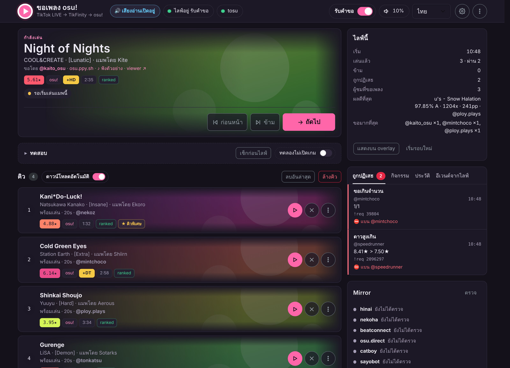
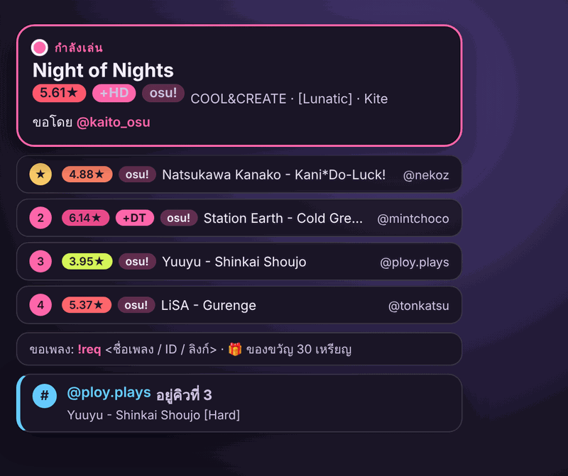
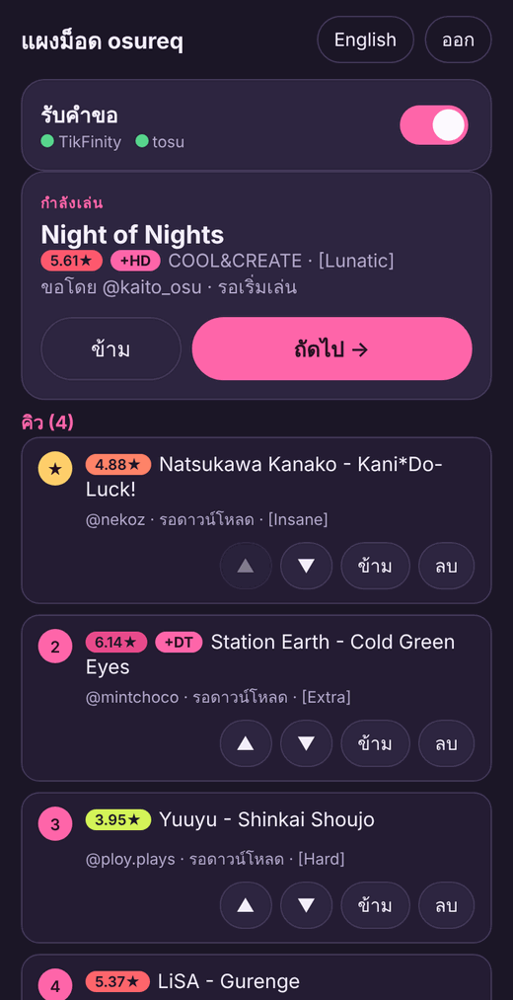

# osureq: ขอเพลง osu! จากแชท TikTok LIVE

[English](../README.md) · **ภาษาไทย**

โปรแกรมช่วยสตรีมเมอร์ osu! บน Windows ให้ผู้ชม TikTok LIVE ขอแมพผ่านแชทได้ด้วย `!req <ID หรือลิงก์>`
osureq ตรวจกฎ ดาวน์โหลดแมพ ตรวจไฟล์ แล้วเปิดแมพใน osu! ให้ทีละเพลง พร้อมแดชบอร์ดคุมคิว (ไทย/อังกฤษ) และ overlay สำหรับ OBS
ทั้งหมดอยู่ใน `osureq.exe` ไฟล์เดียว ไม่ต้องติดตั้ง

[](https://github.com/Lacrymiraosu/tiktoklivereqsong/actions/workflows/build.yml)

## ภาพรวม

**แดชบอร์ด**: เพลงที่กำลังเล่น คิวพร้อมปุ่มจัดการ คำขอที่ถูกปฏิเสธ ประวัติ และสรุปไลฟ์



| Overlay ใน OBS | แผงม็อดบนมือถือ |
|---|---|
|  |  |
| สิ่งที่ผู้ชมเห็นในไลฟ์: เพลงที่กำลังเล่น คิวถัดไป วิธีขอเพลง และคำตอบ `!pos` `!np` หรือเหตุผลที่คำขอถูกปฏิเสธ | ม็อดคุมคิวจากมือถือที่ต่อ Wi-Fi เดียวกัน ใช้ PIN |

<sub>ภาพหน้าจอใช้ข้อมูลตัวอย่าง</sub>

## ความสามารถ

* รับคำขอจากแชท TikTok ผ่าน TikFinity หรือ**รับจาก TikTok โดยตรง** ไม่ต้องเปิดโปรแกรมอื่น (ดู [รับแชทโดยไม่ใช้ TikFinity](#รับแชทโดยไม่ใช้-tikfinity)) รองรับทั้ง ID ลิงก์ osu! ทุกรูปแบบ และ**ชื่อเพลง** (`!req freedom dive`) ขอพร้อม **mod** ได้ (`!req 2096297 HDHR`)
* ขอ**หลายแมพในข้อความเดียว**ได้ถ้าเปิดไว้ (`!req 2096297 1859353 HDHR` ได้สูงสุด 5 แมพ ดู [ขอหลายแมพในข้อความเดียว](#ขอหลายแมพในข้อความเดียว))
* ตรวจกฎ: ช่วงดาว (ตั้งแยกตามโหมดได้) ความยาว โหมด สถานะแมพ จำนวนคำขอต่อคน คูลดาวน์ แมพซ้ำ รายชื่อแบน เฉพาะผู้ติดตาม
* ดาวน์โหลดจาก mirror (hinai → Nekoha → beatconnect → osu.direct → catboy.best → Sayobot → เว็บ osu! ทางการ ถ้าเจ้าไหนล่มจะไปเจ้าถัดไป) และตรวจ MD5 ให้ตรงกับเวอร์ชันล่าสุดบน osu!
* เปิดแมพเข้า osu! (stable และ lazer) เมื่อกด **ถัดไป** หรือเปิดเองอัตโนมัติเมื่อเพลงก่อนหน้าเล่นจบ (ดูจาก tosu)
* รองรับครบ 4 โหมด: osu!, taiko, catch, mania (แมพ convert ใช้ดาวของโหมดนั้นจาก osu!)
* overlay บอกผู้ชมว่าคำขอเข้าคิวหรือถูกปฏิเสธเพราะอะไร แสดงเพลงที่เล่นอยู่ คิวถัดไป และผลการเล่น
* คำสั่งผู้ชม (`!pos` ดูลำดับคิว, `!np` ดูเพลงที่เล่นอยู่, `!voteskip` โหวตข้ามเพลง) ตอบบน overlay พร้อมรูปโปรไฟล์ TikTok
* คำสั่งม็อด (`!skip`, `!remove`, `!reqon`, `!reqoff`), คิวพิเศษจากของขวัญ, โหมดขอเพลงด้วยของขวัญ, แบนคลิกเดียว, ฟังตัวอย่างเพลง
* แผงทดสอบ: จำลองแชทและของขวัญ โหมดทดลองที่ไม่เปิดเกมจริง และปุ่ม **เช็กก่อนไลฟ์** ที่ตรวจทั้งระบบให้ในครั้งเดียว
* สรุปไลฟ์ (เล่นไปกี่เพลง ผลดีที่สุด ใครขอเยอะสุด) บนแดชบอร์ด และแสดงบน overlay ได้
* คิวแบบผลัดกัน, ปิด/เปิดรับคำขอเองตามขนาดคิวหรือตามเวลา, แบนทั้งเพลง (ทุกเวอร์ชัน) หรือทั้งศิลปิน (`artist="a_hisa"`)
* ปุ่ม **▶ ดูแมพ** บนการ์ดในคิว เพลงที่กำลังเล่น และประวัติ เปิดตัวเล่นแมพของ [KIKI Beatmap Viewer](https://api.kiki-bm.app/) ใต้การ์ดพร้อม mod ที่ขอ (เฉพาะแมพ osu!standard ดู [ดูแมพในแดชบอร์ด](#ดูแมพในแดชบอร์ด))
* แสดงจำนวนคนที่กำลังดูไลฟ์ (👁 1,234) ข้างสถานะการเชื่อมต่อ ทั้งในแดชบอร์ดและแผงม็อด
* แผงม็อดบนมือถือ (ไม่บังคับ): คุมคิวจากมือถือที่ใช้ Wi-Fi เดียวกัน ป้องกันด้วย PIN
* สตรีมด้วยคอม 2 เครื่อง: OBS บนอีกเครื่องเปิด overlay ผ่านลิงก์ลับได้ ([สตรีม 2 เครื่อง: overlay บนคอม OBS](#สตรีม-2-เครื่อง-overlay-บนคอม-obs))
* อ่านแชทออกเสียง (ไม่บังคับ) แบบไม่อ่านคำสั่ง (`!req …`) ลิงก์ หรืออีโมจิ ใช้แทน TTS ของ TikFinity และประกาศเสียงคำขอ ("test1 ขอเพลง …", "เพลง … ยากเกินไป 7.25 ดาว") ตามข้อความที่ตั้งเอง ([แนะนำ](#เสียงอ่าน-tts-แนะนำให้ใช้ของ-osureq))
* ไฟล์ช่วยแก้ปัญหา (log, อีเวนต์ดิบ, การตั้งค่า) สำหรับส่งให้คนช่วยดูหลังไลฟ์ที่มีปัญหา
* สลับ stable / lazer ให้เองตามที่ tosu เห็น และอัปเดตตัวเองได้: ดาวน์โหลด osureq ใหม่จากหน้า release บน GitHub ตรวจไฟล์ แล้วติดตั้งตอนเปิดโปรแกรมครั้งหน้า
* ปิด tosu, TikFinity หรือปิดทุกอย่างได้จากแดชบอร์ด

## สิ่งที่ต้องมี

* Windows 10/11 64 บิต
* osu! **stable** หรือ **lazer**
* [**TikFinity Desktop**](https://tikfinity.zerody.one/) เชื่อมกับบัญชี TikTok และเปิดไว้ตอนไลฟ์ (osureq รับแชทผ่าน TikFinity)
  **หรือ**ไม่ต้องมีเลยถ้าเลือก **TikTok โดยตรง** (ตั้งค่า → การเชื่อมต่อ ดู [รับแชทโดยไม่ใช้ TikFinity](#รับแชทโดยไม่ใช้-tikfinity))
* [**tosu**](https://github.com/tosuapp/tosu/releases/latest) เปิดไว้ตอนไลฟ์ (ใช้ดูว่าเพลงเล่นจบหรือยัง และเก็บผลการเล่น)
* OBS หรือ TikTok LIVE Studio ถ้าจะใช้ overlay
* เบราว์เซอร์รุ่นใหม่สำหรับแดชบอร์ด: Chrome หรือ Edge 130, Firefox 132 หรือ Safari 18 ขึ้นไป

## เริ่มใช้งาน

1. ดาวน์โหลด `osureq-<เวอร์ชัน>-windows-x64.zip` จาก [Releases](https://github.com/Lacrymiraosu/tiktoklivereqsong/releases/latest)
   แตกไฟล์ไว้ในโฟลเดอร์ของมันเอง เช่น `C:\osureq\` (โปรแกรมจะสร้าง `config.json`, `queue.json`, `osureq.log` และโฟลเดอร์ `cache\` ไว้ข้าง ๆ)
2. เปิด TikFinity, tosu และ osu!
3. ดับเบิลคลิก `osureq.exe` จะมีหน้าต่าง CMD แสดง log (ปิดหน้าต่างนี้ = ปิดโปรแกรม) และแดชบอร์ดเปิดที่ <http://127.0.0.1:21280/>
4. ไปที่ **ตั้งค่า → osu!** เลือก stable หรือ lazer แล้วตั้งกฎต่าง ๆ (ดาว ความยาว โหมด การแบน ฯลฯ) ได้ที่ปุ่ม **กฎแมพ** เหนือคิว
5. ถ้าจะใช้ overlay ให้เพิ่ม **Browser Source** ใน OBS เป็น `http://127.0.0.1:21280/overlay` (พื้นหลังโปร่งใส)

ลองทั้งระบบก่อนไลฟ์จริงได้ที่แผง **ทดสอบ** บนแดชบอร์ด

### รับแชทโดยไม่ใช้ TikFinity

ไปที่ **ตั้งค่า → การเชื่อมต่อ → รับแชทจาก** เลือก **TikTok โดยตรง** แล้วใส่ชื่อ @ TikTok ของคุณ osureq จะอ่านไลฟ์เอง
ทั้งแชท ของขวัญ และสถานะผู้ชม ไม่ต้องติดตั้งหรือเปิดโปรแกรมอื่น ตอนยังไม่ได้ไลฟ์จะเช็กทุก 30 วินาที และเชื่อมต่อเองทันทีที่เริ่มไลฟ์ ป้ายสถานะด้านบนของแดชบอร์ดจะแสดงจำนวนคนที่กำลังดูอยู่ (👁 1,234) ด้วย แผงม็อดก็แสดงเหมือนกัน
ถ้าใช้ TikFinity ตัวเลขนี้จะขึ้นเฉพาะเมื่อ TikFinity ส่งมาให้

TikTok ยอมให้เชื่อมต่อเฉพาะที่อยู่ที่ถูกเซ็นแล้ว [Euler Stream](https://www.eulerstream.com) เป็นผู้เซ็น (เซิร์ฟเวอร์เดียวกับที่
TikTok-Live-Connector ใช้) นับเฉพาะตอนเชื่อมต่อ แชทไม่นับ ถ้าไม่มี API key เชื่อมต่อได้ 30 ครั้งต่อชั่วโมง 100 ครั้งต่อวัน
พอสำหรับไลฟ์เดียว ถ้าสมัคร key ฟรีที่ eulerstream.com จะได้มากขึ้น ใส่ไว้ที่ **API key ของ Euler Stream** key เก็บไว้ในเครื่องนี้เท่านั้น
และถูกซ่อนในไฟล์ช่วยเหลือ ยังสลับกลับไปใช้ TikFinity ได้ด้วยสวิตช์เดียวกัน

### เสียงอ่าน (TTS): แนะนำให้ใช้ของ osureq

เราแนะนำให้ใช้ TTS ของ osureq แทน TTS ของ TikFinity เพราะ **TTS ของเราพูดชื่อเพลงที่คนขอได้** TikFinity เห็นแค่ข้อความในแชท
เลยอ่าน `!req 129891 HDHR` ออกมาเป็นตัวเลขกับตัวอักษร แต่ osureq รู้ว่าคำขอนั้นคือแมพอะไร จึงพูดชื่อเพลงออกมาได้เลย:

> “test1 ขอเพลง FREEDOM DiVE ของ xi แมพโดย Nakagawa-Kanon ระดับ FOUR DIMENSIONS HDHR”

* ประกาศว่าเกิดอะไรกับคำขอ: เพิ่มเข้าคิว, ถูกปฏิเสธพร้อมเหตุผล (“เพลง FREEDOM DiVE ยากเกินไป 7.25 ดาว”), เพลงถัดไป, `!np`,
  ผลการเล่น และของขวัญ แก้ข้อความได้ทุกบรรทัดที่ **ตั้งค่า → เสียงอ่าน** โดยใช้ `{title}` `{artist}` `{mapper}` `{diff}` `{mods}` `{stars}` และอื่นๆ
* อ่านแชทอื่นๆ ด้วย แต่ไม่อ่านคำสั่ง (`!req …`) ลิงก์ หรืออีโมจิ
* เลือกอ่านเฉพาะใจส้ม (subscriber) ผู้ติดตาม คนส่งของขวัญ หรือม็อดได้

วิธีใช้: ที่ **ตั้งค่า → เสียงอ่าน** เปิด **อ่านแชทออกเสียง** และ **ประกาศคำขอด้วยเสียง** ถ้าเปิด TikFinity อยู่ให้ **ปิด TTS ของ TikFinity** เพื่อไม่ให้อ่านซ้ำ
เสียงอ่านจะเริ่มเองเมื่อเปิดแดชบอร์ด (ถ้าเบราว์เซอร์ให้คลิกก่อน คลิกตรงไหนก็ได้ในหน้า) และ OBS จับเสียงได้ผ่าน Desktop Audio
Windows ไม่มีเสียงไทยมาให้ ตัวเลือก **ใครพูด: auto** จึงใช้เสียงของ Google สำหรับภาษาไทย ซึ่งจะส่งข้อความที่อ่านไปที่ Google

### ผู้ชมพิมพ์อะไรได้บ้าง

```
!req 2096297                                      ← ID ของ diff (ถ้าไม่เจอจะลองเป็น ID ของเซ็ต)
!req https://osu.ppy.sh/beatmapsets/962870#mania/2096297
!req https://osu.ppy.sh/beatmapsets/962870        ← ทั้งเซ็ต: เลือก diff ที่ยากที่สุดที่ผ่านกฎ
!req freedom dive                                 ← ชื่อเพลง: เลือกแมพชื่อตรงที่เล่นเยอะที่สุดที่ผ่านกฎ
!req 2096297 HDHR                                 ← ขอพร้อม mod (ถ้าขอด้วยชื่อเพลง ให้ต่อท้ายด้วย +HDHR)
!remove                                           ← ลบคำขอล่าสุดของตัวเอง
!pos                                              ← คำขอของฉันอยู่คิวที่เท่าไร
!np                                               ← ตอนนี้ osu! เล่นเพลงอะไร (ดูจาก tosu) ใครขอ
```

ถ้าเปิดโหวตข้ามเพลงไว้ (ตั้งค่า → คำสั่ง) ผู้ชมพิมพ์ `!voteskip` ได้ ม็อดใช้ `!skip` (ข้ามเพลงที่เล่นอยู่), `!remove @ชื่อ`, `!reqon` / `!reqoff` (เปิด/ปิดรับคำขอ) ได้
ชื่อคำสั่งทั้งหมดเปลี่ยนได้ในการตั้งค่า

### ขอหลายแมพในข้อความเดียว

ปกติข้อความหนึ่งขอได้ 1 แมพ ถ้าอยากให้ขอได้มากกว่านั้น ให้ตั้งที่ **ตั้งค่า → คำสั่ง → จำนวนแมพต่อข้อความ** (1 ถึง 5) แล้วผู้ชมจะพิมพ์ขอทีเดียวหลายแมพได้
โดย mod ให้พิมพ์ต่อท้ายแมพที่จะใช้ mod นั้น:

```
!req 2096297 1859353 HDHR 1521430                 ← ขอ 3 แมพ HDHR ใช้กับ 1859353
```

* ใช้ได้เมื่อทุกคำหลังคำสั่งเป็น ID ลิงก์ osu! หรือ mod เท่านั้น ถ้าเป็นชื่อเพลง หรือมี ID แล้วตามด้วยข้อความอื่น
  (`!req 2096297 please`) จะทำงานเหมือนเดิม
* แต่ละแมพผ่านกฎทุกข้อแยกกัน และนับรวมในจำนวนคำขอต่อคน แมพเดียวกันที่พิมพ์ซ้ำนับครั้งเดียว ถ้า mod ผิด (เช่น `+HDXX`)
  จะปฏิเสธเฉพาะแมพนั้น
* คูลดาวน์เช็กครั้งเดียวต่อข้อความ ถ้าที่ติดเป็นเรื่องของผู้ชม (คูลดาวน์ ขอครบจำนวนแล้ว คิวเต็ม ปิดรับคำขอ ถูกแบน เฉพาะผู้ติดตาม ยังไม่ส่งของขวัญ)
  แมพที่เหลือจะไม่ถูกดำเนินการต่อ และขึ้นป๊อปอัปครั้งเดียว แมพที่เกินจำนวนที่ตั้งไว้จะถูกข้าม พร้อมป๊อปอัปบอก
* ถ้าเปิดโหมดขอเพลงด้วยของขวัญ แต่ละแมพใช้สิทธิ์ขอ 1 ครั้ง
* overlay แสดงทุกแมพ ส่วนเสียงอ่านจะพูดผลแต่ละแบบแค่ครั้งเดียว และไม่เกิน 2 บรรทัดต่อข้อความ
* ในแผง **ทดสอบ** พิมพ์ ID หรือลิงก์ได้เลย (ตามด้วย mod ได้ เช่น `2096297 HDHR`) โปรแกรมเติมคำสั่งให้เอง

### ดูแมพในแดชบอร์ด

ปุ่ม **▶ ดูแมพ** บนการ์ดในคิว เพลงที่กำลังเล่น และประวัติ จะเปิดตัวเล่นแมพใต้การ์ด แสดงแมพพร้อมเสียงฮิตและ mod ที่ผู้ชมขอ
เปิดได้ทีละอัน และตอนเริ่มเล่นจะหยุดเสียงตัวอย่าง ♪ (เปิดเสียงตัวอย่างก็จะหยุดตัวเล่นเหมือนกัน)

* ตัวเล่นคือ [KIKI Beatmap Viewer](https://api.kiki-bm.app/) (player.kiki-bm.app) ใช้ฟรี ไม่ต้องมี key ทำงานในเบราว์เซอร์ของคุณ
  osureq ไม่ได้โหลดสคริปต์ใดจาก KIKI แค่แสดงหน้าของเขาในกรอบและส่งข้อความหากัน
* เล่นได้เฉพาะแมพ osu!standard ส่วน taiko, catch, mania และแมพ convert ไม่มีปุ่ม ▶ ประวัติที่บันทึกไว้ก่อนที่ osureq จะเก็บโหมดก็ไม่มีปุ่มเหมือนกัน
* ถ้า osureq ดาวน์โหลดและตรวจไฟล์แมพนั้นไว้แล้ว ตัวเล่นจะใช้ไฟล์นั้น ถ้าไม่มีก็โหลดจากมิเรอร์ของชุมชนเอง
  ถ้าโหลดไม่สำเร็จ ให้กด ▶ ในตัวเล่นอีกครั้ง osureq จะให้ตัวเล่นไปใช้มิเรอร์แทน
* เครดิต ⓘ ของตัวเล่นยังแสดงอยู่ตามที่ KIKI กำหนด (สกินและเสียงฮิตเริ่มต้นเป็นของ ppy ภายใต้ CC BY-NC 4.0)
* ปิดได้ที่ **ตั้งค่า → osu! → ตัวดูแมพ KIKI** (สวิตช์หนึ่งสำหรับแดชบอร์ด อีกอันสำหรับแผงม็อด) แผงม็อดก็มีปุ่ม ▶ แบบเดียวกัน
  แต่โหลดแมพจากมิเรอร์เสมอ ลิงก์ "viewer ↗" ไปยังเว็บดูแมพยังอยู่เหมือนเดิม ค่าเริ่มต้นคือเว็บของ KIKI Beatmap Viewer (kiki-bm.app)
  หรือใส่เว็บของคุณเองที่ **ตั้งค่า → osu! → URL ของ beatmap viewer**

### สตรีม 2 เครื่อง: overlay บนคอม OBS

OBS ที่อยู่อีกเครื่องเปิด `http://127.0.0.1:21280/overlay` ไม่ได้ ให้ใช้ลิงก์ลับแทน:

1. **ตั้งค่า → แผงม็อด**: เปิดแผงม็อดแล้วกดบันทึก ลิงก์นี้ใช้พอร์ตของแผงม็อด (ค่าเริ่มต้น 21281)
2. **ตั้งค่า → โอเวอร์เลย์**: เปิด **ให้คอมอีกเครื่องเปิด overlay ได้** แล้วกดบันทึก จะมีลิงก์ขึ้นมา
   (`http://<ที่อยู่ของคอมเครื่องนี้>:21281/o/<รหัสลับ>`) พร้อมปุ่มคัดลอก
3. บนคอมที่เปิด OBS เพิ่ม **Browser Source** ใส่ลิงก์นี้ (พื้นหลังโปร่งใสเหมือน overlay ปกติ)

* คอมทั้งสองเครื่องต้องอยู่เครือข่ายเดียวกัน (ไม่ใช่ Wi-Fi สำหรับแขก) และต้องอนุญาต osureq ผ่านไฟร์วอลล์ Windows สำหรับเครือข่ายส่วนตัว เหมือนแผงม็อด
* ลิงก์นี้แสดงได้แค่ overlay เปลี่ยนแปลงอะไรไม่ได้ และแดชบอร์ดยังเปิดได้เฉพาะเครื่องนี้ แต่ overlay มีชื่อผู้ชมและเพลงที่ขอ
  ใครในเครือข่ายที่มีลิงก์ก็เห็นได้ จึงควรเก็บลิงก์ไว้ใช้เอง กด **สร้างลิงก์ใหม่** (ที่เดียวกัน) เพื่อเปลี่ยนรหัสลับ
  ลิงก์เก่าจะใช้ไม่ได้ทันที ต้องนำลิงก์ใหม่ไปวางใน OBS
* ถ้าเครื่องไหนเดาลิงก์ผิดหลายครั้ง จะถูกบล็อก 10 นาที เหมือนใส่ PIN ผิด
* เสียงอ่านยังเล่นที่เครื่องที่เปิดแดชบอร์ดอยู่ และปุ่ม **เช็กก่อนไลฟ์** นับ overlay นี้ด้วย
* ทดสอบแล้วในเบราว์เซอร์บนเครื่องเดียว (รวมถึงผ่านที่อยู่ในเครือข่าย) ยังไม่ได้ลองกับ OBS บนคอมเครื่องที่สองจริง

## การทำงาน

```
แชท TikTok ──► TikFinity ──WebSocket──► osureq ──► osu.ppy.sh (ข้อมูลแมพ, MD5)
                                          │
                                          ├──► mirror: hinai, Nekoha, … (ดาวน์โหลด .osz) ──► cache\
                                          ├──► osu! (เปิด .osz หรือคัดลอกเข้า Songs)
          tosu ──WebSocket (สถานะเกม)────►│
                                          └──► แดชบอร์ด + overlay (http://127.0.0.1:21280)
```

1. **รับแชท**: TikFinity ส่งข้อความแชทและของขวัญมาทาง WebSocket (`ws://127.0.0.1:21213/`) หรือถ้าเลือก TikTok โดยตรง
   osureq อ่านจาก WebSocket ไลฟ์ของ TikTok เอง (Euler Stream เป็นผู้เซ็นการเชื่อมต่อ)
   osureq สนใจเฉพาะข้อความที่ขึ้นต้นด้วยคำสั่ง เช่น `!req`
2. **ตรวจผู้ขอ**: เช็กรายชื่อแบน คิวเต็มหรือยัง จำนวนคำขอต่อคน และคูลดาวน์ โดยไม่ต้องใช้เน็ต
3. **อ่านข้อมูลแมพ**: ดึงหน้าแมพจาก osu.ppy.sh (ไม่ต้องใช้ API key) เพื่อเอาชื่อเพลง ดาว ความยาว โหมด สถานะ และ MD5 ของแต่ละ diff
   ถ้าขอด้วยชื่อเพลง จะค้นใน mirror ก่อน (hinai ถ้าล่มไป Nekoha, osu.direct, catboy.best) แล้วลองแมพที่ชื่อตรงที่สุด (เล่นเยอะสุดก่อน) จนกว่าจะเจอแมพที่ผ่านกฎ
4. **ตรวจกฎแมพ**: ดาว ความยาว โหมด สถานะ แมพซ้ำ และแมพที่เพิ่งเล่นไป
   ถ้าไม่ผ่าน overlay จะขึ้นเหตุผลให้ผู้ชมเห็น เพราะ TikFinity เขียนกลับลงแชท TikTok ไม่ได้
5. **เข้าคิว**: คิวถูกบันทึกใน `queue.json` ปิดเปิดโปรแกรมใหม่คิวก็ยังอยู่ ส่วนคนที่ส่งของขวัญครบจะได้คิวพิเศษ (ถ้าเปิดไว้)
6. **ดาวน์โหลดและตรวจไฟล์**: โหลด `.osz` จาก mirror ตามลำดับที่ตั้งไว้ ทีละแมพ แล้วตรวจ MD5 ของไฟล์ `.osu` ข้างในกับข้อมูลจาก osu!
   ถ้า mirror มีไฟล์เวอร์ชันเก่าจะลองแหล่งถัดไป แมพถัด ๆ ไปจะโหลดล่วงหน้าไว้ให้กดเล่นได้ทันที (ปิดได้ที่สวิตช์ **ดาวน์โหลดอัตโนมัติ** เหนือคิว)
7. **เปิดแมพ**: กด **ถัดไป** บนแดชบอร์ดหรือคีย์ลัด osureq จะเปิด `.osz` ให้ osu! นำเข้าแล้วกระโดดไปที่แมพนั้น
8. **โหมดอัตโนมัติ**: osureq ติดตามสถานะเกมจาก tosu เมื่อแมพที่เปิดถูกเล่นจริงแล้วผู้เล่นออกจากหน้าผลคะแนน
   แมพถัดไปจะเปิดเองหลังรอไม่กี่วินาที ผลการเล่น (ความแม่น อันดับ คอมโบ miss pp mods) จะถูกเก็บไว้และขึ้นบน overlay
   ถ้า tosu หลุด โหมดอัตโนมัติจะหยุดรอ ไม่มีการเดาด้วยตัวจับเวลา

แดชบอร์ดของ osureq ฟังแค่ `127.0.0.1` เครื่องอื่นในเครือข่ายเข้าไม่ได้ มีแค่แผงม็อดและลิงก์ overlay (ที่ต้องเปิดใช้เองทั้งคู่) ที่เครื่องอื่นเปิดได้
และต้องมี PIN หรือลิงก์ลับ ส่วนการดาวน์โหลดทำได้เฉพาะโดเมนที่อนุญาตไว้เท่านั้น

รายละเอียดเชิงลึก (โครงสร้างโค้ด, API, การตั้งค่าทุกตัว, การทดสอบ) อยู่ใน [DEVELOPMENT.md](DEVELOPMENT.md) (ภาษาอังกฤษ)

## วิธี build

ต้องมี [Go](https://go.dev/dl/) 1.23 ขึ้นไปบน Windows (`winget install GoLang.Go`)

```powershell
git clone https://github.com/Lacrymiraosu/tiktoklivereqsong.git
cd tiktoklivereqsong
.\build.ps1 -Version 1.5.0
```

`build.ps1` จะรัน `go vet` และ `go test` ก่อน สร้างไฟล์ resource ของ Windows (ไอคอน ชื่อ เวอร์ชัน) แล้ว build ออกมาเป็น `dist\osureq.exe`
ถ้า PowerShell ไม่ยอมรันสคริปต์ ให้ build เองด้วย:

```powershell
$env:CGO_ENABLED = "0"
go run ./tools/winres -version 1.5.0
go build -trimpath -ldflags "-X main.version=1.5.0" -o dist\osureq.exe .
```

### สำหรับคนที่จะแก้โค้ด

* `main.go` ต่อสายทุกอย่าง โค้ดหลักอยู่ใน `internal/<โมดูล>` แยกหน้าที่ชัดเจน หน้าเว็บอยู่ใน `internal/server/web` และถูกฝังลงใน exe
* รัน `go vet ./...` และ `go test ./...` ก่อนและหลังแก้ทุกครั้ง
* อ่าน [Rules for contributors](DEVELOPMENT.md#rules-for-contributors) ก่อนแก้โค้ด และห้ามกด ถัดไป บนเครื่องจริงโดยไม่เปิดโหมดทดลอง (Dry run)

### Build และ release อัตโนมัติด้วย GitHub Actions

* ทุกครั้งที่ push เข้า `main` หรือเปิด pull request, GitHub จะ vet, test และ build ให้ ไฟล์ exe อยู่ในหน้า Actions 14 วัน
* ปล่อยเวอร์ชันใหม่: อัปเดตเลขเวอร์ชันใน `build.ps1` (และ changelog) แล้ว merge เข้า `main` จากนั้นเลือกทางใดทางหนึ่ง
  * ไม่ต้องใช้ git: เปิด **Actions → build → Run workflow** เลือก `main` ใส่เลขเวอร์ชัน (เช่น `1.5.0`) แล้วกด **Run workflow**
  * หรือ push tag

  ```powershell
  git tag v1.5.0
  git push origin v1.5.0
  ```

  GitHub จะ build ด้วยเลขเวอร์ชันจาก tag แล้วสร้าง Release พร้อม `osureq-<เวอร์ชัน>-windows-x64.zip` (มี exe, `LICENSE` และ `THIRD_PARTY_LICENSES.txt`) และไฟล์ `.sha256`

## เครดิต

ข้อมูลแมพ ภาพปก และตัวอย่างเพลงมาจาก osu! (ppy Pty Ltd) แมพเป็นของผู้สร้างแมพ (mapper) และเพลงเป็นของศิลปินเจ้าของเพลง

* ไอเดีย: [chaiwat2183](https://osu.ppy.sh/users/21039251)
* [osu!](https://osu.ppy.sh) โดย ppy Pty Ltd: ตัวเกม
* [TikFinity](https://tikfinity.zerody.one/) โดย zerody: ส่งแชทและของขวัญจาก TikTok LIVE
* [Euler Stream](https://www.eulerstream.com): เซ็นการเชื่อมต่อแบบ TikTok โดยตรง, [gotiktoklive](https://github.com/steampoweredtaco/gotiktoklive)
  สำหรับรูปแบบข้อความของ TikTok LIVE และ [TikTok-Live-Connector](https://github.com/zerodytrash/TikTok-Live-Connector) ที่เป็นตัวอย่างวิธีเชื่อมต่อ
* [tosu](https://github.com/tosuapp/tosu): อ่านสถานะเกม osu! แบบสด
* [KIKI Beatmap Viewer](https://api.kiki-bm.app/): ตัวเล่นแมพหลังปุ่ม ▶ (player.kiki-bm.app) ใช้ฟรีและไม่ต้องมี key
* Mirror ดาวน์โหลดไฟล์ `.osz`: [hinai](https://mirror.hinamizawa.ai), [Nekoha](https://mirror.nekoha.moe), [beatconnect](https://beatconnect.io), [osu.direct](https://osu.direct), [catboy.best](https://catboy.best) และ [Sayobot](https://osu.sayobot.cn) (hinai, Nekoha, osu.direct และ catboy.best ใช้ค้นหาเพลงด้วย)
* ไลบรารี Go: [coder/websocket](https://github.com/coder/websocket), [golang.org/x/sys](https://pkg.go.dev/golang.org/x/sys), [protobuf-go](https://github.com/protocolbuffers/protobuf-go),
  [tc-hib/winres](https://github.com/tc-hib/winres), [nfnt/resize](https://github.com/nfnt/resize), [golang.org/x/image](https://pkg.go.dev/golang.org/x/image)
* [Bootstrap](https://getbootstrap.com) 6 (พร้อม [Floating UI](https://floating-ui.com) และ [Vanilla Calendar Pro](https://github.com/uvarov-frontend/vanilla-calendar-pro)): ส่วนประกอบของแดชบอร์ด
* ฟอนต์: [Kanit](https://fonts.google.com/specimen/Kanit), [IBM Plex Sans Thai](https://fonts.google.com/specimen/IBM+Plex+Sans+Thai), [IBM Plex Mono](https://fonts.google.com/specimen/IBM+Plex+Mono) และ [Varela Round](https://fonts.google.com/specimen/Varela+Round) (overlay) จาก Google Fonts

osureq เป็นโปรเจกต์ของแฟนเกม ไม่มีส่วนเกี่ยวข้องและไม่ได้รับการรับรองจาก ppy Pty Ltd, TikTok, TikFinity, Euler Stream, KIKI Beatmap Viewer หรือ tosu
osu! เป็นเครื่องหมายการค้าของ ppy Pty Ltd และ TikTok เป็นเครื่องหมายการค้าของเจ้าของ

## License

[MIT](../LICENSE) © 2026 kikinomae ส่วน license ของโค้ดภายนอกที่ถูก build รวมไว้ใน `osureq.exe` (Go standard library,
`golang.org/x/sys`, `coder/websocket`, `protobuf-go` และรูปแบบข้อความจาก gotiktoklive) อยู่ใน [THIRD_PARTY_LICENSES.txt](../THIRD_PARTY_LICENSES.txt)
